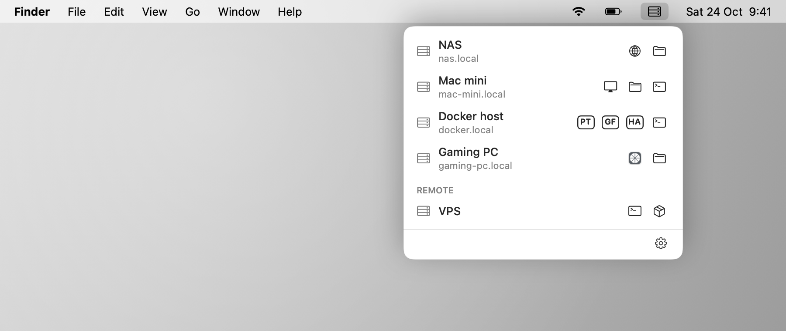
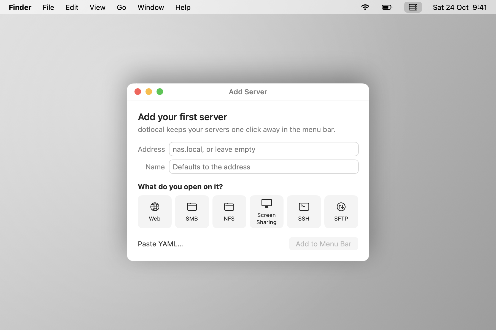
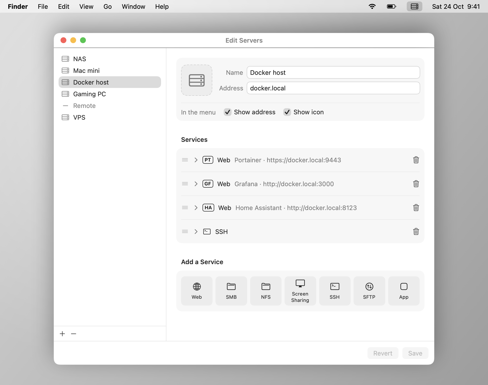

# dotlocal

Your home servers, one click away from the Mac menu bar.

<p align="center">
  <picture>
    <source media="(prefers-color-scheme: dark)" srcset="docs/screenshots/menu-dark.png">
    
  </picture>
</p>

dotlocal lives in the menu bar (no Dock icon). Click it to see your servers, each
with a button per service. Click a button and macOS opens the right tool:

| Service | Opens |
|---|---|
| `web` | your default browser |
| `smb`, `nfs` | Finder |
| `vnc` | Screen Sharing |
| `ssh` | Terminal (or your default ssh:// handler) |
| `sftp` | your default sftp:// handler |
| `app` | any Mac app, e.g. Windows App for Remote Desktop |

Nothing is auto-discovered. You describe your servers once, and they live in a
YAML file you can keep, sync and share.

## Install

**[Download dotlocal](https://github.com/njkuhne/Lanyard/releases/latest/download/dotlocal.dmg)**
(the latest version), open it, and drag dotlocal into Applications. Requires
macOS 13 or later. Older versions and release notes are on the
[Releases](https://github.com/njkuhne/Lanyard/releases) page.

## Use

On first launch dotlocal asks for your first server: its address, and what you
open on it.

<p align="center">
  
</p>
 After that, the gear menu has **Edit Servers…** (a form), and
its **Edit YAML…** button opens the raw file in its own window (paste a whole setup in). Right-click a server in
the menu to edit just that one, copy its address, or open any of its services.

<p align="center">
  
</p>

```yaml
servers:
  - name: NAS
    address: nas.local
    services:
      - web: https://nas.local:5001
      - smb

  - name: Docker host
    address: docker.local
    services:
      - web: { url: "https://docker.local:9443", name: Portainer, badge: PT }
      - web: { url: "http://docker.local:3000", name: Grafana, badge: GF }
      - ssh: ssh://admin@docker.local

  - divider: Remote

  - name: Windows PC
    address: pc.local
    show_address: false
    services:
      - app: com.microsoft.rdc.macos
```

- **Servers** have a `name`, an `address`, an optional `icon` (any SF Symbol),
  and `show_address: false` / `show_icon: false` to tidy the menu.
- **Services** are a type and one address: `- web: https://nas.local:5001/admin`,
  `- ssh: ssh://root@nas.local:2222`. Leave the address out (`- smb`) to use the
  server's.
- Give a service a `name` (tooltips and menus) and either an `icon` or a `badge`
  of 1–3 characters, which is handy when a box runs several web apps.
- `- divider` adds a line, `- divider: Title` a labelled section. Order in the
  file is order in the menu.

Passwords are never stored; macOS and your Keychain handle those. The file is
`servers.yaml` in dotlocal's Application Support folder inside its sandbox
container, and dotlocal reloads it when it changes.

## Build

Requires Xcode 15 or later.

```sh
open dotlocal.xcodeproj     # then ⌘R
swift test                 # tests, including UI snapshot tests
scripts/coverage.sh        # fails unless the logic is 100% covered
scripts/make-dmg.sh        # builds build/dotlocal-<version>.dmg
SCREENSHOTS=1 swift test --filter ScreenshotTests   # regenerates docs/screenshots
```

## Releasing

See [RELEASING.md](RELEASING.md) for cutting a release, CI builds, and signing.

## License

MIT
