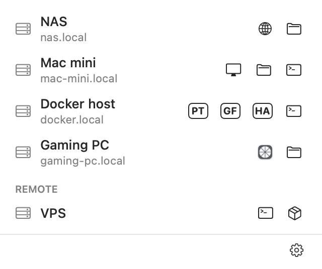
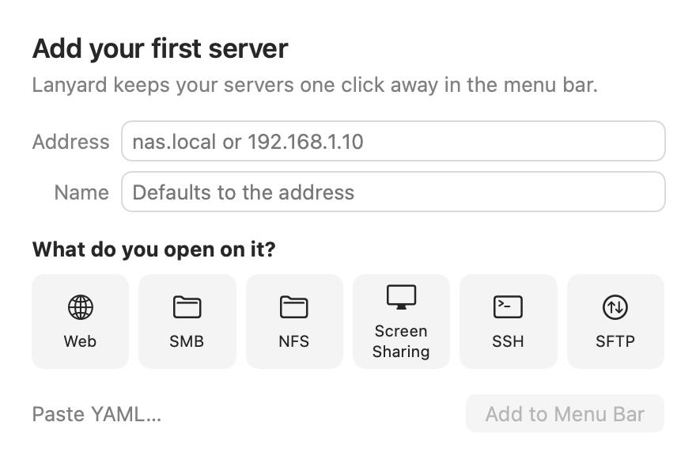
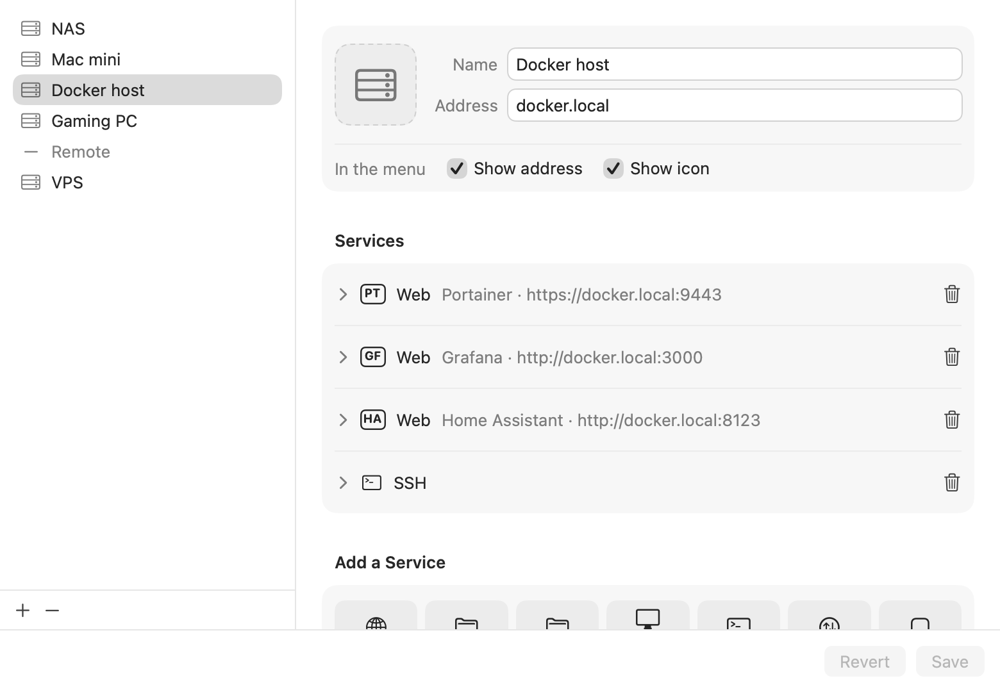

# Lanyard

Your home servers, one click away from the Mac menu bar.

<p align="center">
  <picture>
    <source media="(prefers-color-scheme: dark)" srcset="Tests/LanyardTests/__Snapshots__/menu-dark.png">
    
  </picture>
</p>

Lanyard lives in the menu bar (no Dock icon). Click it to see your servers, each
with a button per service. Click a button and macOS opens the right tool:

| Service | Opens |
|---|---|
| `web` | your default browser |
| `smb`, `nfs` | Finder |
| `vnc` | Screen Sharing |
| `ssh` | Terminal (or your default ssh:// handler) |
| `sftp` | your default sftp:// handler |
| `app` | any Mac app, e.g. Windows App for Remote Desktop |

Nothing is auto-discovered. You describe your servers once, and they live in a
YAML file you can keep, sync and share.

## Install

**[Download Lanyard](https://github.com/njkuhne/Lanyard/releases/latest/download/Lanyard.dmg)**
(the latest version), open it, and drag Lanyard into Applications. Requires
macOS 13 or later. Older versions and release notes are on the
[Releases](https://github.com/njkuhne/Lanyard/releases) page.

## Use

On first launch Lanyard asks for your first server: its address, and what you
open on it.

<p align="center">
  
</p>
 After that, the gear menu has **Edit Servers…** (a form) and
**Edit YAML…** (the raw file; paste a whole setup in). Right-click a server in
the menu to edit just that one, copy its address, or open any of its services.

<p align="center">
  
</p>

```yaml
servers:
  - name: NAS
    address: nas.local
    services:
      - web: https://nas.local:5001
      - smb

  - name: Docker host
    address: docker.local
    services:
      - web: { url: "https://docker.local:9443", name: Portainer, badge: PT }
      - web: { url: "http://docker.local:3000", name: Grafana, badge: GF }
      - ssh: ssh://admin@docker.local

  - divider: Remote

  - name: Windows PC
    address: pc.local
    show_address: false
    services:
      - app: com.microsoft.rdc.macos
```

- **Servers** have a `name`, an `address`, an optional `icon` (any SF Symbol),
  and `show_address: false` / `show_icon: false` to tidy the menu.
- **Services** are a type and one address: `- web: https://nas.local:5001/admin`,
  `- ssh: ssh://root@nas.local:2222`. Leave the address out (`- smb`) to use the
  server's.
- Give a service a `name` (tooltips and menus) and either an `icon` or a `badge`
  of 1–3 characters, which is handy when a box runs several web apps.
- `- divider` adds a line, `- divider: Title` a labelled section. Order in the
  file is order in the menu.

Passwords are never stored; macOS and your Keychain handle those. The file is
`servers.yaml` in Lanyard's Application Support folder inside its sandbox
container, and Lanyard reloads it when it changes.

## Build

Requires Xcode 15 or later.

```sh
open Lanyard.xcodeproj     # then ⌘R
swift test                 # tests, including UI snapshot tests
scripts/coverage.sh        # fails unless the logic is 100% covered
scripts/make-dmg.sh        # builds build/Lanyard-<version>.dmg
```

## Releasing

Every tag is a release. To cut one from a clean, pushed `main`:

```sh
scripts/release.sh minor        # or patch, major, 1.4.0, 1.5.0-beta.1
```

That bumps the version, commits, tags `vX.Y.Z` and pushes. GitHub then tests,
builds the DMG, writes release notes from the commits since the last tag, and
publishes the release marked **Latest**. A tag with a suffix (`v1.5.0-beta.1`)
becomes a pre-release instead. You can also push a tag by hand, or use
**Actions → Release → Run workflow**. Every push to `main` also builds a DMG you
can grab from the run's Artifacts.

Without signing secrets the DMG is unsigned, and macOS asks people to approve it
in System Settings → Privacy & Security on first open. To ship a DMG that opens
cleanly, it needs a **Developer ID Application** certificate and notarization.
Add these repository secrets (details in `.github/workflows/release.yml`):
`DEVELOPER_ID`, `DEVELOPER_ID_P12`, `DEVELOPER_ID_P12_PASSWORD`,
`NOTARY_KEY_P8`, `NOTARY_KEY_ID` and `NOTARY_ISSUER`.

To sign and notarize locally instead:

```sh
xcrun notarytool store-credentials lanyard-notary   # once
DEVELOPER_ID="Developer ID Application: Your Name (TEAMID)" \
NOTARY_PROFILE=lanyard-notary scripts/make-dmg.sh
```

## License

MIT
